<!-- ⚠️ Troque todas as ocorrências de J0s0ao pelo seu username do GitHub -->

 

 

  

 

## 🎓 Sobre mim

Sou **João Vitor Raimundi**, graduando em **Ciência da Computação** no **IFC – Campus Concórdia**. Meu foco principal é o **desenvolvimento backend**: modelagem de dados, construção de APIs e arquitetura de aplicações. Também gosto de mexer com hardware e IoT usando Arduino.

- 🔭 Aprofundando meus conhecimentos em **backend e bancos de dados**
- 🐳 Explorando **containers** e ambientes reproduzíveis com Docker
- 🌱 Sempre aprendendo algo novo
- 💬 Vamos trocar uma ideia sobre tecnologia!

 

## 🧰 Stack principal

  

 

## 💻 Linguagens e tecnologias

  

<b>📋 Ver lista completa</b>

 

| Categoria | Tecnologias |
|:--|:--|
| **Backend** | Python · NodeJS · PHP · C# |
| **Linguagens** | Python · JavaScript · TypeScript · C · C# · PHP |
| **Front-end** | HTML · CSS · JavaScript |
| **Bancos de dados** | PostgreSQL · MySQL |
| **DevOps** | Docker |
| **Embarcados / IoT** | C · Arduino IDE |

 

## 📊 Nível de afinidade

 

 

## 📈 Estatísticas do GitHub

 

  

 

## 📫 Vamos conversar?

  

⭐ Se curtiu o perfil, deixa uma estrela em algum repositório!

